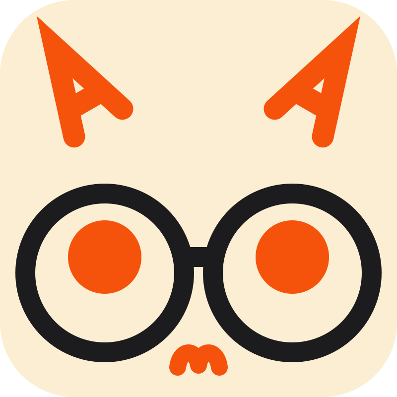

<p align="center">
  
</p>

<h1 align="center">AooMooa Notch</h1>

<p align="center">
  把 MacBook 的刘海，变成一块会呼吸的小屏幕。
</p>

<p align="center">
  <a href="https://github.com/aoomooa/aoomooa_notch/releases/latest/download/aoomooa-notch.dmg"><strong>下载 DMG（v1.1.0）</strong></a>
  ·
  <a href="https://aoomooa.art/notch/">项目页</a>
  ·
  <a href="scripts/sentinel/README.md">AI 哨兵接入指南</a>
  ·
  <a href="https://github.com/TheBoredTeam/boring.notch">上游 Boring Notch</a>
</p>

> **AooMooa Notch 是 [Boring Notch](https://github.com/TheBoredTeam/boring.notch)（v2.7.3）的 GPLv3 个人化 fork。**
> 原始项目由 [The Bored Team](https://github.com/TheBoredTeam) 维护。这个 fork 更换了应用名（`aoomooa🉐刘海屏`）、四眼猫矢量图标与 Bundle ID（`com.aoomooa.notch`），并围绕极简三页工作流与本地 AI 任务监控做了深度定制。它不是 Apple 官方产品，与 Apple 无关。

## 它是什么

刘海不只是屏幕的缺口。AooMooa Notch 把展开面板收敛为极简三页，并在收起态引入零打扰的 AI 状态小灯：

- **第 1 页 · 首页**：正在播放（音乐/视频实时封面取色）· 常用网站 2×2（自动抓取真实站名与图标）· 独立 AI 入口
- **第 2 页 · 工作台**：实时系统状态（CPU / 内存 / 磁盘 / 网络 / 温度，仅在可见时采样）· 4×2 混合启动器（本地 App + 网页）
- **第 3 页 · 时间**：日历提醒（顶栏集成 `wttr.in` 紧凑天气）· 预设 + 滚轮紧凑计时器
- **AI 任务哨兵**（Antigravity · Claude · DeepSeek Harness）：
  - 纯本机回环（`127.0.0.1:17425`、`X-Notch-Token` 鉴权、拒绝浏览器 `Origin`），空闲 `0%` CPU、零系统弹窗打扰、不落盘任何消息内容
  - 收起态左耳排 AI 原生 Logo、右耳按 `左1↔右1` 一一对应亮灯（灰呼吸=工作中 · 绿=完成 · 红=需确认/出错 · 橙=长时间没消息）
  - 播放视频或音乐时自动与 AI 镜像对称共存，封面带柔波扩散环与银幕呼吸溢光，暂停即自动收翼
- **极简交互**：悬停展开、3 秒延迟收起、记住上次停留页、三栏全中文极简设置、刘海任意空白处右键打开设置或退出（不占程序坞与菜单栏）

详见 [AI 任务哨兵接入指南](scripts/sentinel/README.md)。

## 安装

**系统要求：** macOS 14 Sonoma 或更新版本，Apple Silicon 或 Intel Mac。

1. 从 [Releases](https://github.com/aoomooa/aoomooa_notch/releases) 下载 `aoomooa-notch.dmg`。
2. 打开 DMG，把 **aoomooa🉐刘海屏.app** 拖进 `/Applications`。
3. 第一次打开时，macOS 可能提示“无法验证开发者”。这是因为目前没有 Apple Developer 签名。到 **系统设置 → 隐私与安全性** 允许，或执行：

```bash
xattr -dr com.apple.quarantine "/Applications/aoomooa🉐刘海屏.app"
```

然后正常打开。启动后把鼠标移到屏幕顶部中间，刘海就会展开；右键刘海可随时打开设置或退出应用。

> 这是未签名构建。请只从本仓库的 Releases 或源码构建，不要从第三方转载站下载。

## 从源码构建与打包

需要 macOS 15.6+、Xcode 26+（与上游一致）。

```bash
git clone https://github.com/aoomooa/aoomooa_notch.git
cd aoomooa_notch
./scripts/build-install.sh      # Release 编译、临时签名并安装到 /Applications/aoomooa🉐刘海屏.app
./scripts/package-dmg.sh        # 封装 dist/aoomooa-notch.dmg 并生成 SHA-256 校验值
```

Bundle ID 为 `com.aoomooa.notch`。

## 开源与署名

- 本仓库代码以 **GNU GPLv3** 发布，完整文本见 [LICENSE](LICENSE)。
- 上游项目：[TheBoredTeam/boring.notch](https://github.com/TheBoredTeam/boring.notch)（基于 v2.7.3）。
- 本 fork 的修改、来源和版权说明见 [NOTICE.md](NOTICE.md)。
- 项目页：[https://aoomooa.art/notch/](https://aoomooa.art/notch/)。

如果你分发这个 fork 的修改版，请保留 GPLv3、保留上游署名，并公开对应源码。

## 致谢

- [The Bored Team](https://github.com/TheBoredTeam) 与 Boring Notch 的所有贡献者
- [MediaRemoteAdapter](https://github.com/ungive/mediaremote-adapter)
- [NotchDrop](https://github.com/Lakr233/NotchDrop)
- 图标：四眼猫，由 aoomooa 绘制

完整第三方许可见 [THIRD_PARTY_LICENSES](THIRD_PARTY_LICENSES)。
