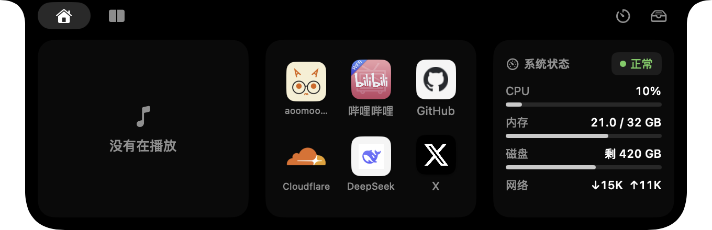
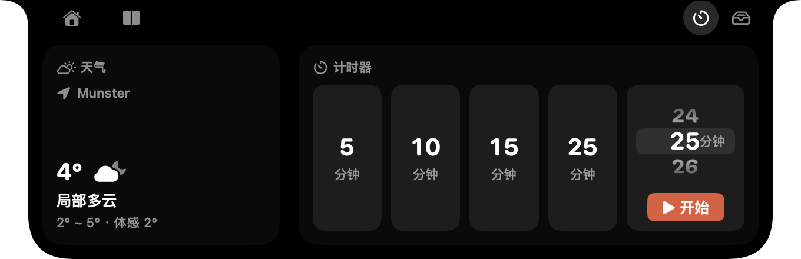

<p align="center">
  
</p>

<h1 align="center">AooMooa Notch</h1>

<p align="center">
  把 MacBook 的刘海，变成一块会呼吸的小屏幕。
</p>

<p align="center">
  <a href="https://github.com/aoomooa/aoomooa_notch/releases/latest/download/aoomooa-notch.dmg"><strong>下载 DMG</strong></a>
  ·
  <a href="https://aoomooa.art/notch/">项目页</a>
  ·
  <a href="https://github.com/TheBoredTeam/boring.notch">上游 Boring Notch</a>
</p>



> **AooMooa Notch 是 [Boring Notch](https://github.com/TheBoredTeam/boring.notch) 的一个 GPLv3 fork。**
> 原始项目由 [The Bored Team](https://github.com/TheBoredTeam) 维护。这个 fork 换了名字、图标和 Bundle ID，并做了一些个人化调整；核心功能来自上游。它不是 Apple 官方产品，与 Apple 无关。

## 它是什么

刘海不只是屏幕的缺口。AooMooa Notch 让它可以展开成：

- 音乐控制和实时可视化
- 日历 / 提醒
- 文件架与 AirDrop
- 系统状态 HUD（CPU、内存、磁盘、网络）
- 计时器、天气
- 手势、刘海尺寸调节

鼠标移到屏幕顶部中间，或者点击刘海，它会展开；移开，它缩回去。没有新窗口，也没有 Dock 图标。

## 安装

**系统要求：** macOS 14 Sonoma 或更新版本，Apple Silicon 或 Intel Mac。

1. 从 [Releases](https://github.com/aoomooa/aoomooa_notch/releases) 下载 `aoomooa-notch.dmg`。
2. 打开 DMG，把 **aoomooa🉐刘海屏.app** 拖进 `/Applications`。
3. 第一次打开时，macOS 可能提示“无法验证开发者”。这是因为目前没有 Apple Developer 签名。到 **系统设置 → 隐私与安全性** 允许，或执行：

```bash
xattr -dr com.apple.quarantine "/Applications/aoomooa🉐刘海屏.app"
```

然后正常打开。启动后把鼠标移到屏幕顶部中间，刘海就会展开。

> 这是未签名构建。请只从本仓库的 Releases 或源码构建，不要从第三方转载站下载。

## 从源码构建

需要 macOS 15.6+、Xcode 26+（与上游一致）。

```bash
git clone https://github.com/aoomooa/aoomooa_notch.git
cd aoomooa_notch
open boringNotch.xcodeproj
```

在 Xcode 里运行 `boringNotch` scheme。Bundle ID 为 `com.aoomooa.notch`。

## 开源与署名

- 本仓库代码以 **GNU GPLv3** 发布，完整文本见 [LICENSE](LICENSE)。
- 上游项目：[TheBoredTeam/boring.notch](https://github.com/TheBoredTeam/boring.notch)。
- 本 fork 的修改、来源和版权说明见 [NOTICE.md](NOTICE.md)。
- 项目页：[https://aoomooa.art/notch/](https://aoomooa.art/notch/)。

如果你是分发这个 fork 的修改版，请保留 GPLv3、保留上游署名，并公开对应源码。

## 截图

| 文件架 + 系统状态 | 计时器 + 天气 |
| --- | --- |
|  |  |

音乐 / 日历界面的实机参考截图：[docs/music.png](docs/music.png)。截图来自 Boring Notch 的界面，用于展示同一套上游功能。

## 致谢

- [The Bored Team](https://github.com/TheBoredTeam) 与 Boring Notch 的所有贡献者
- [MediaRemoteAdapter](https://github.com/ungive/mediaremote-adapter)
- [NotchDrop](https://github.com/Lakr233/NotchDrop)
- 图标：四眼猫，由 aoomooa 绘制

完整第三方许可见 [THIRD_PARTY_LICENSES.md](THIRD_PARTY_LICENSES.md)。
